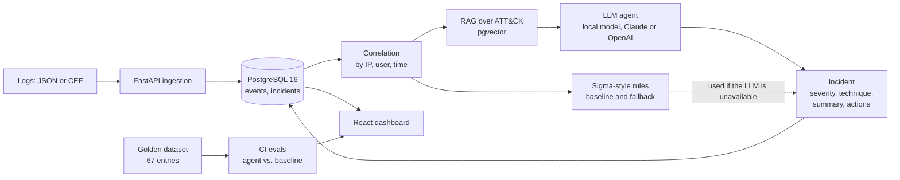

# SOC Copilot

An LLM agent that turns a batch of security logs into a short list of explained incidents: severity, MITRE ATT&CK technique, a plain-language summary and suggested next steps. Every answer is measured against a deterministic Sigma-style rule baseline.

<!-- Add after deploy: live demo link and a 20-second GIF. -->

## Eval results

<!-- EVAL_RESULTS_START -->
| Metric | Sigma-style rules | LLM agent | Target |
| --- | ---: | ---: | ---: |
| Detection recall | 56% | not run yet |  |
| Detection precision | 65% | not run yet |  |
| Severity accuracy | 56% | not run yet | ≥ 75% |
| ATT&CK tactic accuracy | 56% | not run yet | ≥ 70% |
| ATT&CK technique accuracy | 56% | not run yet | ≥ 65% |
| False positives on benign activity | 13 of 24 | not run yet | |
| Detection recall on evasive attacks | 0% | not run yet | |

67 labelled entries: 43 attacks and 24 benign, 15 of them held out. Accuracy is over the attack entries, and a missed attack counts as wrong. The agent column fills in once the eval suite runs with an LLM API key.
<!-- EVAL_RESULTS_END -->

The table is generated from [`evals/results.json`](evals/results.json) by `python backend/scripts/update_readme.py`.

The golden dataset ([`backend/tests/evals/golden_labels.json`](backend/tests/evals/golden_labels.json)) has three kinds of entry:

| Kind | Entries | What it is |
| --- | ---: | --- |
| Standard | 24 | The five scenarios at the volumes the rules were written for. The baseline catches all of them. |
| Evasive | 19 | The same attacks slowed down or reshaped to stay under fixed thresholds: low-and-slow brute force, password spraying, a 30-minute port scan, phishing from a domain with valid SPF, lateral movement to two hosts, a slow DNS tunnel. The baseline catches none. |
| Benign | 24 | Ordinary activity, 13 entries of it shaped to trip a rule: a CI runner retrying an expired key, monitoring health checks, a forwarded newsletter, the nightly backup, CDN hostnames. |

## Architecture



| Component | Technology |
| --- | --- |
| API | FastAPI, SQLAlchemy 2 async, Pydantic v2, Python 3.12 |
| Storage | PostgreSQL 16 with pgvector (384-dimension `all-MiniLM-L6-v2` embeddings) |
| LLM | Pluggable provider: a local model through Ollama (`qwen2.5:3b`, the default), Claude (`claude-sonnet-5-5`) or OpenAI |
| Baseline | Five deterministic rules in `backend/app/services/sigma_rules.py` |
| Frontend | React 18, TypeScript, Vite, Tailwind, React Query |
| Evals | pytest and DeepEval, run in GitHub Actions |

## Run it

```bash
docker compose up -d --build
docker compose exec api python scripts/generate_logs.py   # load sample logs
```

Open the dashboard at <http://localhost:3000>. The API docs are at <http://localhost:8000/docs>.

No API key is needed. The stack runs its own [Ollama](https://ollama.com) and downloads `qwen2.5:3b` (about 2 GB) on first start; the MITRE techniques are seeded at the same time. On a laptop CPU the model takes one to two minutes per incident. If the model does not answer, the Sigma rules classify the events and the response says so.

To use a hosted model, or a different local one, create `.env` from `.env.example`:

```bash
LLM_PROVIDER=claude          # or openai; then set ANTHROPIC_API_KEY or OPENAI_API_KEY
OLLAMA_MODEL=qwen2.5:7b      # or a larger local model, if the machine can run it
```

Then group the sample logs into incidents and analyze each group:

```bash
curl -X POST http://localhost:8000/api/v1/analyze/auto -H 'Content-Type: application/json' -d '{}'
```

### API

| Endpoint | What it does |
| --- | --- |
| `POST /api/v1/events`, `/events/batch`, `/events/cef` | Ingest events as JSON or CEF lines |
| `POST /api/v1/analyze` | Classify one group of events (`event_ids` or inline `events`) |
| `POST /api/v1/analyze/auto` | Group all unassigned events by IP, user and time, then analyze each group |
| `GET /api/v1/incidents`, `/incidents/{id}` | List (filter by severity, tactic, status) and read incidents |
| `GET /api/v1/metrics` | The latest eval report |

### Local development

```bash
docker compose up -d db redis
cd backend
python -m venv .venv && source .venv/bin/activate
pip install torch --index-url https://download.pytorch.org/whl/cpu
pip install -r requirements-dev.txt
python scripts/seed_mitre.py
python scripts/generate_logs.py
uvicorn app.main:app --reload            # API on :8000

cd ../frontend && npm install && npm run dev   # dashboard on :5173
```

### Tests and evals

```bash
pytest -v                               # unit tests; no database or API key needed
pytest backend/tests/evals -m eval -v   # evals; writes evals/results.json
python backend/scripts/update_readme.py # refresh the table above
```

The baseline half of the evals runs anywhere. The agent half needs Postgres with the techniques seeded and a model to call (Ollama running, or an API key); without them those tests are skipped and the previous agent results are kept. One agent run makes 68 LLM calls, which takes about two hours with the local model on a laptop CPU.

To rebuild the golden dataset after changing the generators: `python backend/scripts/build_golden.py`.

## Decisions and trade-offs

- **Correlate in code, classify with the LLM.** Events are grouped by shared IP or user within a time window before the model sees them, so the model reads one candidate incident at a time and cost scales with incidents, not log lines.
- **Rules run first and stay.** The Sigma-style rules are the comparison floor in the evals and the fallback when the LLM is down, rate-limited or declines.
- **RAG instead of the whole ATT&CK matrix in the prompt.** pgvector returns the five closest techniques. On the golden attacks the right technique is in the top five for 42 of 43 entries and in the top three for 34, which is why the default is five.
- **A written severity policy.** One four-level policy (`backend/app/services/severity.py`) is shared by the rules, the prompt and the labels, so a severity disagreement is a judgement about the events and not about the scale.
- **The agent can say "not an incident".** Benign entries make up a third of the dataset, so false positives are measured and not assumed away.
- **Pluggable provider.** `LLM_PROVIDER` switches between Claude, OpenAI and Ollama behind one interface, to compare cost and quality on the same evals. The default is a small local model so the project runs with no account and no key.
- **Refusal fallback.** Security logs can trip a model's safety classifiers. The Claude provider opts in to server-side fallback, which re-runs a declined request on another model inside the same call.

## Known limitations

- The logs are synthetic. The scenarios come from generators in `backend/scripts/generate_logs.py`, not from a lab or production capture.
- Only 15 ATT&CK techniques are indexed.
- No parsers for raw log formats (syslog lines, Windows event exports, Nginx access logs); events arrive as JSON or CEF.
- No migrations: tables are created on startup. No authentication.
- The agent suggests actions and never executes them.
- Redis is in the stack but not used yet.
- The default local model is small (3 billion parameters) and slow on CPU, well over the 10-second latency target. A hosted model or a GPU changes both.

## Next steps

Run the agent evals and publish the numbers, deploy a public demo, add an LLM-as-judge score for explanation quality, then replace the synthetic dataset with attacks captured in a lab.
