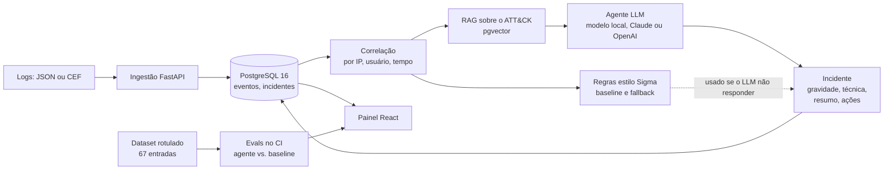

# SOC Copilot

[English](README.md) · **Português (Brasil)**

Um agente de LLM que transforma um lote de logs de segurança em uma lista curta de incidentes explicados: gravidade, técnica do MITRE ATT&CK, um resumo em linguagem simples e os próximos passos sugeridos. Cada resposta é medida contra um baseline determinístico de regras no estilo Sigma.

<!-- Adicionar depois do deploy: link da demo ao vivo e um GIF de 20 segundos. -->

## Resultados dos evals

<!-- EVAL_RESULTS_START -->
| Métrica | Regras estilo Sigma | Agente LLM (qwen2.5:7b) | Meta |
| --- | ---: | ---: | ---: |
| Recall de detecção | 56% | 98% |  |
| Precisão de detecção | 65% | 70% |  |
| Acerto de gravidade | 56% | 98% | ≥ 75% |
| Acerto de tática ATT&CK | 56% | 72% | ≥ 70% |
| Acerto de técnica ATT&CK | 56% | 72% | ≥ 65% |
| Falsos positivos em atividade benigna | 13 de 24 | 18 de 24 | |
| Recall de detecção em ataques evasivos | 0% | 95% | |
| Latência p95 por análise | 0,4 ms | 363,7 s | < 10 s |
| Custo de LLM por análise | $0 | $0,0000 | |

67 entradas rotuladas: 43 ataques e 24 benignas, 15 delas separadas como conjunto de teste. O acerto é calculado sobre os ataques, e um ataque não detectado conta como erro. Rodada do agente: 2026-11-18.
<!-- EVAL_RESULTS_END -->

A tabela é gerada a partir de [`evals/results.json`](evals/results.json) por `python backend/scripts/update_readme.py`, que atualiza este arquivo e a versão em inglês.

O dataset rotulado ([`backend/tests/evals/golden_labels.json`](backend/tests/evals/golden_labels.json)) tem três tipos de entrada:

| Tipo | Entradas | O que é |
| --- | ---: | --- |
| Padrão | 24 | Os cinco cenários nos volumes para os quais as regras foram escritas. O baseline pega todos. |
| Evasivo | 19 | Os mesmos ataques mais lentos ou remodelados para ficar abaixo de limites fixos: brute force lento, password spraying, um port scan de 30 minutos, phishing de um domínio com SPF válido, movimento lateral para dois hosts, um túnel DNS lento. O baseline não pega nenhum. |
| Benigno | 24 | Atividade comum, 13 entradas dela montadas para disparar uma regra: um runner de CI tentando de novo com uma chave expirada, health checks de monitoramento, uma newsletter encaminhada, o backup noturno, hostnames de CDN. |

## Arquitetura



| Componente | Tecnologia |
| --- | --- |
| API | FastAPI, SQLAlchemy 2 async, Pydantic v2, Python 3.12 |
| Armazenamento | PostgreSQL 16 com pgvector (embeddings `all-MiniLM-L6-v2` de 384 dimensões) |
| LLM | Provedor plugável: um modelo local via Ollama (`qwen2.5:3b`, o padrão), Claude (`claude-sonnet-5-5`) ou OpenAI |
| Baseline | Cinco regras determinísticas em `backend/app/services/sigma_rules.py` |
| Frontend | React 18, TypeScript, Vite, Tailwind, React Query |
| Evals | pytest e DeepEval, rodando no GitHub Actions |

## Como rodar

```bash
docker compose up -d --build
docker compose exec api python scripts/generate_logs.py   # carrega logs de exemplo
```

Abra o painel em <http://localhost:3000>. A documentação da API fica em <http://localhost:8000/docs>.

Não precisa de API key. A stack sobe o próprio [Ollama](https://ollama.com) e baixa o `qwen2.5:3b` (cerca de 2 GB) na primeira execução; as técnicas do MITRE são carregadas ao mesmo tempo. Num CPU de notebook o modelo leva de um a dois minutos por incidente. Se o modelo não responder, as regras Sigma classificam os eventos e a resposta avisa.

Para usar um modelo hospedado, ou outro modelo local, crie o `.env` a partir do `.env.example`:

```bash
LLM_PROVIDER=claude          # ou openai; depois preencha ANTHROPIC_API_KEY ou OPENAI_API_KEY
OLLAMA_MODEL=qwen2.5:7b      # ou um modelo local maior, se a máquina aguentar
```

Depois agrupe os logs de exemplo em incidentes e analise cada grupo:

```bash
curl -X POST http://localhost:8000/api/v1/analyze/auto -H 'Content-Type: application/json' -d '{}'
```

### API

| Endpoint | O que faz |
| --- | --- |
| `POST /api/v1/events`, `/events/batch`, `/events/cef` | Recebe eventos em JSON ou em linhas CEF |
| `POST /api/v1/analyze` | Classifica um grupo de eventos (`event_ids` ou `events` no corpo) |
| `POST /api/v1/analyze/auto` | Agrupa todos os eventos ainda sem incidente por IP, usuário e tempo, e analisa cada grupo |
| `GET /api/v1/incidents`, `/incidents/{id}` | Lista (com filtro por gravidade, tática e status) e lê incidentes |
| `GET /api/v1/metrics` | O relatório de evals mais recente |

### Desenvolvimento local

```bash
docker compose up -d db redis
cd backend
python -m venv .venv && source .venv/bin/activate
pip install torch --index-url https://download.pytorch.org/whl/cpu
pip install -r requirements-dev.txt
python scripts/seed_mitre.py
python scripts/generate_logs.py
uvicorn app.main:app --reload            # API na porta 8000

cd ../frontend && npm install && npm run dev   # painel na porta 5173
```

### Publicar uma demo

O `docker-compose.prod.yml` roda a stack num servidor só (4 GB de RAM bastam com um modelo hospedado). O [Caddy](https://caddyserver.com) é o único serviço com portas abertas, a 80 e a 443, e obtém o certificado TLS sozinho; o Postgres e a API ficam dentro da rede do compose. Aponte um registro DNS para o servidor e rode:

```bash
cp .env.example .env    # preencha DOMAIN, POSTGRES_PASSWORD e ANTHROPIC_API_KEY
docker compose -f docker-compose.prod.yml up -d --build
docker compose -f docker-compose.prod.yml exec api python scripts/seed_demo.py
```

O `seed_demo.py` carrega os cinco cenários de exemplo e os transforma em incidentes, com uma chamada ao LLM cada, para o visitante já encontrar o painel preenchido.

O arquivo de produção liga o `DEMO_MODE`, que deixa a API somente leitura. A única escrita que continua aberta é o `POST /analyze`, que não salva nada e tem limite de uso: `DEMO_ANALYSES_PER_IP_PER_HOUR` (5) por visitante e `DEMO_ANALYSES_PER_DAY` (200) somando todos, o que limita a conta do LLM. Configure também um limite de gasto na API key, no console do provedor. Os limites ficam em memória, então zeram quando a API reinicia.

### Testes e evals

```bash
pytest -v                               # testes unitários; não precisam de banco nem de API key
pytest backend/tests/evals -m eval -v   # evals; gera evals/results.json
python backend/scripts/update_readme.py # atualiza a tabela acima
```

A parte do baseline roda em qualquer lugar. A parte do agente precisa do Postgres com as técnicas carregadas e de um modelo para chamar (Ollama no ar, ou uma API key); sem isso, esses testes são pulados e os resultados anteriores do agente são mantidos. Uma rodada do agente faz 68 chamadas ao LLM, o que leva cerca de duas horas com o modelo local num CPU de notebook.

Para regenerar o dataset rotulado depois de mudar os geradores: `python backend/scripts/build_golden.py`.

## Decisões e trade-offs

- **Correlacionar no código, classificar com o LLM.** Os eventos são agrupados por IP ou usuário em comum, dentro de uma janela de tempo, antes de o modelo vê-los. Assim o modelo lê um incidente candidato por vez, e o custo cresce com o número de incidentes, não de linhas de log.
- **As regras rodam primeiro e continuam.** As regras estilo Sigma são o piso de comparação nos evals e o fallback quando o LLM está fora do ar, limitado ou recusa a resposta.
- **RAG em vez da matriz ATT&CK inteira no prompt.** O pgvector devolve as cinco técnicas mais próximas. Nos ataques do dataset, a técnica certa está entre as cinco primeiras em 42 de 43 entradas e entre as três primeiras em 34, por isso o padrão é cinco.
- **Uma política de gravidade escrita.** Uma única política de quatro níveis (`backend/app/services/severity.py`) é compartilhada pelas regras, pelo prompt e pelos rótulos. Assim, uma divergência de gravidade é um julgamento sobre os eventos, não sobre a escala. O modelo não escreve o número: ele nomeia o estágio do ataque (nenhum, reconhecimento, tentativa, sucesso) e o código converte para a escala. Com o qwen2.5:7b, isso levou o acerto de gravidade de 28% para 65%.
- **Os eventos seguram o modelo.** Sozinho, o qwen2.5:7b chamava a maioria dos port scans e dos brute force sem login de "sucesso". O `backend/app/services/evidence.py` procura passos de ataque nos eventos (login depois de falhas repetidas, download, uma origem alcançando outros hosts, formato de túnel DNS, e-mail suspeito, varredura) e limita o estágio ao que eles mostram, o que levou o acerto de gravidade de 65% para 98%. Quando os eventos não mostram nenhum passo de ataque, o "incidente" do modelo é derrubado. As duas coisas só valem quando todos os eventos são de tipos que as checagens sabem ler; no resto, quem decide é o modelo.
- **O agente pode dizer "não é incidente".** As entradas benignas são um terço do dataset, então os falsos positivos são medidos, não ignorados.
- **Provedor plugável.** O `LLM_PROVIDER` alterna entre Claude, OpenAI e Ollama atrás de uma única interface, para comparar custo e qualidade nos mesmos evals. O padrão é um modelo local pequeno, para o projeto rodar sem conta e sem chave.
- **Fallback de recusa.** Logs de segurança podem disparar os filtros de segurança de um modelo. O provedor Claude usa o fallback no servidor, que reexecuta uma requisição recusada em outro modelo dentro da mesma chamada.

## Limitações conhecidas

- Os logs são sintéticos. Os cenários vêm dos geradores em `backend/scripts/generate_logs.py`, não de um laboratório nem de uma captura em produção.
- Só 15 técnicas do ATT&CK estão indexadas.
- Não há parsers para formatos de log brutos (linhas de syslog, exportações de eventos do Windows, logs de acesso do Nginx); os eventos chegam em JSON ou CEF.
- Não há migrações: as tabelas são criadas na inicialização. Não há autenticação: uma publicação na internet depende do modo demo (somente leitura e com limite de uso).
- O agente sugere ações e nunca as executa.
- O Redis está na stack, mas ainda não é usado.
- O modelo local padrão é pequeno (3 bilhões de parâmetros) e lento em CPU, bem acima da meta de 10 segundos de latência. Um modelo hospedado ou uma GPU mudam as duas coisas.
- Falsos positivos: 18 das 24 entradas benignas na rodada medida. O veto aos grupos sem passo de ataque veio depois dessa rodada; passando as respostas dela por ele, sobram 7, mas uma rodada completa ainda não confirmou. Os 7 restantes (um runner de CI com chave vencida, o job de backup) são iguais aos ataques nos eventos e pedem um inventário de ativos conhecidos, não mais checagens.
- As checagens de evidência foram escritas olhando o dataset, então o conjunto de teste separado é a medida mais justa: gravidade de 9 em 10 ali.
- O estágio do ataque ainda puxa algumas táticas para Lateral Movement (acerto de tática de 72%, contra 77% antes do estágio).

## Próximos passos

Medir o veto aos falsos positivos numa rodada completa, adicionar um inventário de ativos conhecidos, rodar uma vez com um modelo hospedado para ter latência e custo reais, publicar uma demo, adicionar uma nota de LLM-as-judge para a qualidade das explicações e, depois, trocar o dataset sintético por ataques capturados em laboratório.
